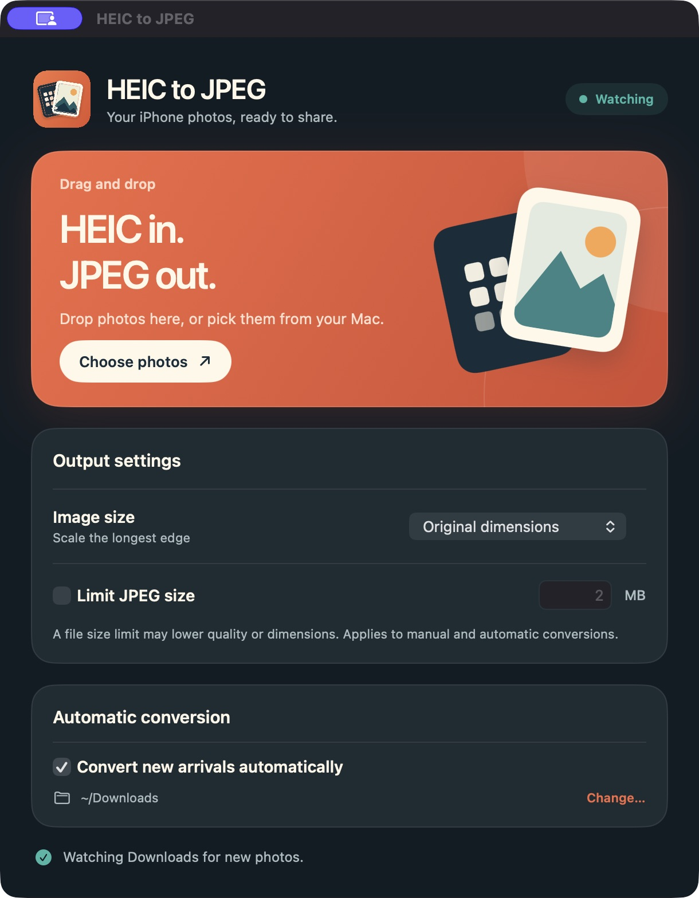

# HEIC to JPEG for Mac

A small native Mac app for turning iPhone HEIC photos into JPEGs. Drop photos onto the window, choose them from Finder, or have the app watch your AirDrop folder for new arrivals.



## Download

Get the latest Mac app from [Releases](https://github.com/rcostache230/heic-to-jpeg-mac/releases/latest). Unzip it and move **HEIC to JPEG.app** to Applications. The release is built for Apple Silicon and macOS 14 or later. It is ad hoc signed, not notarized, so macOS may ask you to approve opening it in **System Settings → Privacy & Security**.

## What it does

- Converts HEIC and HEIF photos to JPEG in the same folder, keeping the originals.
- Watches a chosen folder for newly arrived photos while the app is running. Existing photos are left alone when watching starts.
- Offers original dimensions or large, medium, and small output sizes.
- Optionally targets a maximum JPEG file size in MB; the app lowers quality and, if needed, dimensions to meet it.
- Keeps conversions on your Mac. No account or upload is involved.

To get started, open the app and select **Choose photos**, or enable **Convert new arrivals automatically** and choose your Downloads folder. You can change the watched folder at any time.

## Build from source

Install Xcode Command Line Tools, then run:

```sh
./scripts/build.sh
```

The app is created at `.build/HEIC to JPEG.app`. The build uses only macOS frameworks. The included icon source is in `Artwork/make_icon.py` and requires Pillow if you want to regenerate it; the checked-in resources are enough to build the app.

## License

MIT. See [LICENSE](LICENSE).
